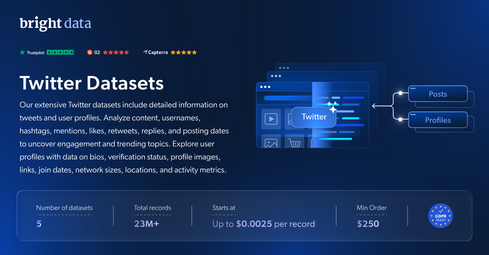

# Twitter 数据集样本

<h2>包含 1001 条 Twitter 帖子的示例数据集</h2>

<a href="https://www.bright.cn/products/datasets/twitter">
   
</a>

包含 1000 多条帖子的 Twitter 数据集样本。该数据集使用 <b>Bright Data API</b> 提取。

* ```id```：帖子的唯一标识符
* ```user_posted```：帖子发布者的用户名
* ```name```：帖子发布者的姓名
* ```description```：帖子的文本描述
* ```date_posted```：帖子的发布日期
* ```photos```：帖子所附照片的 URL
* ```videos```：帖子所附视频的 URL
* ```url```：帖子的 URL 链接
* ```quoted_post```：主帖中被引用帖子的详细信息
* ```tagged_users```：帖子中标记的账号列表
* ```replies```：帖子收到的回复总数
* ```reposts```：帖子收到的转发总数
* ```likes```：帖子收到的点赞总数
* ```views```：帖子的总浏览量
* ```external_url```：帖子中包含的外部 URL
* ```hashtags```：帖子中包含的主题标签
* ```followers```：该账号的粉丝数量
* ```biography```：帖子发布者的个人简介
* ```posts_count```：该账号发布的帖子总数
* ```profile_image_link```：账号头像的 URL
* ```following```：用户关注的账号数量
* ```is_verified```：表示用户是否已认证（True/False）
* ```quotes```：帖子被引用的总次数
* ```bookmarks```：帖子被收藏的总次数
* ```parent_post_details```：父级帖子的详细信息（如适用）

以及更多内容。

这是“Twitter 帖子（公开数据）”数据集的示例子集，该数据集包含超过 <b>1,000,000 条帖子</b>。

可用的数据集文件格式：<b>JSON、NDJSON、JSON Lines、CSV 或 Parquet。文件还可选择压缩为 .gz 格式</b>。

数据集交付方式选项：<b>电子邮件、API 下载、Webhook、Amazon S3、Google Cloud Storage、Google Cloud PubSub、Microsoft Azure、Snowflake、SFTP</b>。

更新频率：<b>一次性、每日、每周、每月、每季度或自定义</b>。

可在提取的数据点基础上添加数据扩充服务：<b>按需提供。</b>

<b>[获取完整的 Twitter 数据集](https://www.bright.cn/products/datasets/twitter)</b>。

<a href="https://www.bright.cn/products/datasets/twitter">
   
</a>

<h2>Twitter 数据集有哪些用例？</h2>

<h3>1. 趋势发现</h3>
通过追踪 Twitter 上的公开讨论，发现新兴趋势与机会。监测转发、点赞、回复和提及，以识别关键话题及用户情绪变化。使用 Twitter 数据集深入了解客户观点和不断变化的市场趋势。

<h3>2. 品牌监测</h3>
通过分析 Twitter 数据，了解公众对你的品牌、产品或服务的看法。通过追踪点赞、评论、分享、主题标签和提及带来的热度变化，抢先把握趋势。

<h3>3. 竞争市场洞察</h3>
通过评估竞争品牌的社交媒体活动获得竞争优势。分析 Twitter 上的主题标签、帖子和用户互动，优化你的策略并超越竞争对手。

<h2>面向学术研究人员和 NGO 免费开放网页爬虫工具及数据集</h2>

Bright Initiative 计划为顶尖高校院系和研究人员，以及推动各类环境与社会公益事业的 NGO 和 NPO，提供 Bright Data 的 <b>[爬虫工具 API](https://www.bright.cn/products/web-scraper)</b> 和 <b>[即用型数据集](https://www.bright.cn/products/datasets)</b>。你可以在<b>[此处](https://brightinitiative.com)</b>提交申请。
